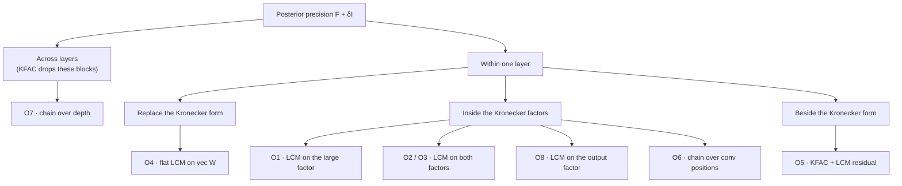

<!-- Status header added 2026-10-27 when this note was moved into the repository. -->

> **Status: the algebra stands, the recommendation does not.**
>
> This note was written on 2026-09-21, before any of it was implemented or measured. It was
> kept outside the repository and its published copy has since become unreachable, so it is
> stored here instead. Read it for the derivation, not for the advice.
>
> **What still holds.** The one-factor eigen reduction and its proof, the closure argument
> that keeps each block inside the family, the explicit block formula, and the finding that
> factored damping must use a trace-balanced constant rather than 1 — with π = 1 the result
> depends on an arbitrary split of the two factors, which costs 141 nats. These were later
> verified numerically; see Experiments 18 to 20 in `experiments/EXPERIMENTS.md` and
> `experiments/kron_lcm_checks.py`, which reproduces the numbers.
>
> **What was built.** The scheme is in the library fork as `hessian_structure="kron_lcm"`.
> On synthetic ordered features it ties KFAC — closing 92.1% of the diagonal-to-full gap
> against 91.8% — using 80× less storage. At 65 536 inputs the factor fits in 0.188 s and
> 1.50 MiB, where a dense KFAC factor would need 32 GiB. One caveat: the library's main
> entry point still routes through a dense Kronecker accumulator that materialises the
> square of the input dimension, so that scale advantage needs the fit called directly
> until a streaming accumulator is written.
>
> **What was falsified.** The note's central recommendation — put the chain on a *learned*
> feature map — does not work. A convolutional network's flattened penultimate factor has an
> effective rank of 1.75 out of 368, seriation agrees with the flattened index at only
> 0.0375, and the chain is significantly worse in distribution (+0.55, 5.6 standard errors)
> with no reliable edge under shift once variance scale is controlled for. Chains belong on
> *physically* ordered axes — wavelengths, time lags, positions — and learned
> representations want low-rank instead. See Experiment 21.
>
> The note anticipated this. Its own summary says the approach "probably fails for hidden
> layers, whose weights mix the inputs", and names Kron-low-rank as the baseline any claim
> here must beat. That is exactly what happened.

---

# KFAC × LCM: Structured Kronecker Factors for Laplace Posteriors

Sep 21, 2026 · @Tomasz K.

## Summary

**One combination is worth building: an LCM on the large Kronecker factor of a rectangular layer, with the small factor eigendecomposed.** It treats the prior exactly and stores about 6 thousand numbers where KFAC stores 4.2 million on a 2048→10 classifier head.

The enabling fact is a reduction. Eigendecompose the small factor G, and the posterior precision A ⊗ G + δI splits into independent problems γⱼA + δI, one per eigenvalue of G. Each of those is again an LCM, so each keeps LCM's linear-time log-determinant, solve and sampling.

| Option | Verdict | Reason |
| --- | --- | --- |
| LCM on the large factor, small factor eigendecomposed | Build it | Exact prior treatment, linear in the large dimension, closed form |
| LCM ⊗ LCM with factored damping | Only when memory-bound | Closed form and tiny, but overconfident by construction |
| LCM ⊗ LCM, exact | Rarely | Exactness needs a dense eigendecomposition of one factor anyway |
| LCM on the whole layer block, no Kronecker | Drop | A layer's curvature is a separable 2-D field; a 1-D chain cannot represent it |
| KFAC plus an additive LCM residual | Research only | Loses the closed form; needs iterative solves and stochastic log-determinants |
| LCM across layers (a chain over depth) | Known method | Reduces to block-tridiagonal KFAC; the chain only compresses each layer's own factors |
| LCM across convolution positions | Estimation only | Weights are shared across positions, so this refines factor estimates, not posterior structure |
| LCM on the output factor | Niche | Only when outputs are ordered: forecast horizons, quantiles, ordinal classes |

**The binding risk is empirical, not algebraic.** The reduction is exact for any factor, but an LCM only helps when the large factor is chain-like. That holds for an input covariance over ordered inputs — wavelengths, time lags, positions in a 1-D feature map — and probably fails for hidden layers, whose weights mix the inputs. The numerical verification section measures this.

**The same machinery works for any factor family closed under scaling and diagonal shifts.** Diagonal-plus-low-rank qualifies, so Kron-low-rank is the natural competitor and must be the baseline for any Kron-LCM claim.

**Two corrections to earlier claims.** Embedding layers are not a KFAC weak point: one-hot inputs make the input factor exactly diagonal. And the reduction is a known identity for Kronecker-structured Gaussian processes; what is new is placing an LCM inside Kronecker-factored Laplace.

## Setup and notation

Every method in this document approximates one matrix: the posterior precision Λ of a Laplace approximation. What separates the methods is what it costs to use Λ.

**Laplace approximation.** With a Gaussian prior N(0, δ⁻¹I) and MAP weights θ\*, the posterior is approximated by a Gaussian around the mode:

```latex
p(\theta \mid \mathcal{D}) \approx \mathcal{N}\big(\theta^\ast,\ \Lambda^{-1}\big), \qquad \Lambda = F + \delta I
```

Three operations consume Λ, and their cost decides which structures are usable:

- **log det Λ** — the Laplace evidence, used to tune the prior precision δ;
- **solves Λ⁻¹v and quadratic forms** — the linearized (GLM) predictive;
- **samples from N(0, Λ⁻¹)** — Monte Carlo predictives.

The evidence the prior is tuned against, for P parameters:

```latex
\log p(\mathcal D) \approx \log p(\mathcal D \mid \theta^\ast) - \tfrac{\delta}{2}\lVert\theta^\ast\rVert^2 + \tfrac{P}{2}\log\delta - \tfrac12\log\det\Lambda
```

**Curvature.** F is the generalized Gauss–Newton matrix (GGN), which is positive semi-definite by construction:

```latex
F = \sum_{n=1}^{N} J_n^\top H_n J_n, \qquad H_n = \nabla_f^2\,\ell(f_n, y_n) \succeq 0, \qquad H_n = L_n L_n^\top
```

With l\_nc the columns of L\_n, the GGN is a sum of rank-1 outer products, one per example and output column. That single fact is what makes both KFAC and the matrix-free LCM fit possible.

**One layer.** A dense layer computes s = W a with W ∈ ℝ^(o×i), input a ∈ ℝ^i (bias appended as a constant 1) and output s ∈ ℝ^o. Stack vec(W) column by column, so the output index runs fastest. Backpropagating l\_nc to s gives g\_nc ∈ ℝ^o, and the chain rule gives an exact Kronecker form per example:

```latex
\operatorname{vec}\big(g\,a^\top\big) = a \otimes g
\quad\Longrightarrow\quad
F_{\ell\ell} = \sum_{n}\sum_{c} \big(a_n a_n^\top\big) \otimes \big(g_{nc}\, g_{nc}^\top\big)
```

**KFAC.** KFAC makes two approximations. It drops every cross-layer block, and it replaces the expectation of a Kronecker product by the Kronecker product of expectations:

```latex
F_{\ell\ell} \approx N\, A \otimes G, \qquad A = \tfrac1N \sum_n a_n a_n^\top \in \mathbb R^{i\times i}, \qquad G = \tfrac1N \sum_{n,c} g_{nc}\, g_{nc}^\top \in \mathbb R^{o\times o}
```

A is the input covariance and G the output-gradient covariance. Only the product is identified: (cA) ⊗ (G/c) is the same matrix for any c > 0.

**LCM.** For an m×m matrix, the Laplace Covariance Model gives each index p a latent coordinate t\_p, a scale w\_p and a nugget d\_p:

```latex
M(t, w, d) = \operatorname{diag}(d) + \operatorname{diag}(w)\,K(t)\,\operatorname{diag}(w), \qquad K(t)_{pq} = e^{-\lvert t_p - t_q\rvert}, \qquad d = \operatorname{softplus}(u) + \varepsilon
```

That is 3m numbers for an m×m matrix. Correlation decays exponentially with distance along the learned line, so M is dense, not banded. The coordinates are called `a` in the code; they are renamed t here to avoid a clash with the activations a.

**Symbols used throughout.** i and o are a layer's input and output widths, m a generic LCM size, N the number of examples, S the number of optimizer steps in an LCM fit, and γⱼ, αₚ the eigenvalues of G and A.

## The LCM toolkit

**Every operation a Laplace posterior needs is exact and linear-time for an LCM, because its latent kernel is a Gauss–Markov chain.** This section derives each one; all of them were checked against dense linear algebra.

**State-space form.** Sort the coordinates so t₁ < … < t\_m. Then M is the covariance of an AR(1) chain observed with noise:

```latex
z_1 \sim \mathcal N(0,1), \quad z_k = \phi_k z_{k-1} + \sqrt{q_k}\,\xi_k, \quad x_k = w_k z_k + \sqrt{d_k}\,\eta_k, \qquad \phi_k = e^{-(t_k - t_{k-1})}, \quad q_k = 1-\phi_k^2
```

This is an Ornstein–Uhlenbeck process (a Matérn-½ Gaussian process) sampled at the points t\_p, plus independent noise. The ordering is what makes it Markov; the spacing sets how fast correlation decays.

**The latent precision is tridiagonal, in closed form.**

```latex
(K^{-1})_{11} = 1 + \frac{\phi_2^2}{q_2}, \qquad (K^{-1})_{kk} = \frac{1}{q_k} + \frac{\phi_{k+1}^2}{q_{k+1}}, \qquad (K^{-1})_{mm} = \frac{1}{q_m}, \qquad (K^{-1})_{k-1,k} = -\frac{\phi_k}{q_k}, \qquad \log\det K = \sum_{k=2}^{m}\log q_k
```

**Solves by Woodbury.** With D = diag(d) and W = diag(w), the correction term is a tridiagonal matrix T, so a solve is one tridiagonal system:

```latex
M^{-1} = D^{-1} - D^{-1} W\, T^{-1}\, W D^{-1}, \qquad T = K^{-1} + W D^{-1} W \quad (\text{tridiagonal})
```

**Log-determinant by the matrix determinant lemma.** The same T gives it, in one banded Cholesky:

```latex
\log\det M = \log\det D + \log\det K + \log\det T
```

**Sampling.** A draw from N(0, M) is the recursion above, O(m). A draw from N(0, M⁻¹) — what a posterior needs — is perturb-and-solve: draw η \~ N(0, M) and return M⁻¹η, whose covariance is M⁻¹MM⁻¹ = M⁻¹.

**Closure under scaling and diagonal shifts.** This is the property every later construction rests on:

```latex
s\,M(t, w, d) + \operatorname{diag}(c) \;=\; M\big(t,\ \sqrt{s}\,w,\ s\,d + c\big), \qquad s \ge 0,\ c \ge 0
```

The coordinates t never change, so a matrix with one sort order stays in the family under any positive scaling and any added diagonal. In particular s·M + δI is again an LCM for every s ≥ 0.

| Operation | Cost | Route | In the library today |
| --- | --- | --- | --- |
| log det M | O(m) | Kalman scan, or the determinant lemma | Yes — `logdet` |
| Quadratic form vᵀM⁻¹v | O(m) | Kalman innovations | Yes — `quad_inv` |
| Solve M⁻¹v, as a vector | O(m) | Woodbury + tridiagonal solve | No — derived and verified here |
| Sample from N(0, M) | O(m) | AR(1) recursion | Yes — `sample` |
| Sample from N(0, M⁻¹) | O(m) | Perturb-and-solve | No |
| Product Mv | O(m) | Two exponentially weighted running sums | Yes — `matvec` |
| Frobenius norm ‖M‖\_F | O(m) | Prefix sums on K(2t) | Yes, inside `fit_frobenius` |

Measured: the Woodbury log-determinant agrees with the dense value and with the library's Kalman scan to ten digits at m = 400. A log-determinant plus one solve takes under 0.2 s at m = 10⁶ on one CPU core.

**One stability caveat.** When adjacent coordinates nearly coincide, φ\_k → 1 and 1/q\_k blows up, so T is ill-conditioned. The Kalman form the library already uses for log-determinants stays stable there; a Kalman filter followed by a backward pass gives the stable version of the solve.

## The Kronecker toolkit

**A Kronecker product is cheap on its own, but the prior breaks it: A ⊗ G + δI is not a Kronecker product.** KFAC restores tractability with a dense eigendecomposition of both factors — exactly the step an LCM factor cannot afford.

**Identities.** With the column-stacking convention above and V ∈ ℝ^(o×i), for symmetric A and G:

```latex
(A\otimes G)\operatorname{vec}(V) = \operatorname{vec}(G\,V A), \qquad (A\otimes G)^{-1} = A^{-1}\otimes G^{-1}, \qquad \log\det(A\otimes G) = o\,\log\det A + i\,\log\det G
```

Each reduces an (io)×(io) operation to operations on the two small factors. None of them survives adding δI.

**Exact prior, as KFAC does it.** Eigendecompose both factors, A = Q\_A diag(α) Q\_Aᵀ and G = Q\_G diag(γ) Q\_Gᵀ. The shared eigenbasis diagonalises the prior too:

```latex
A\otimes G + \delta I = (Q_A\otimes Q_G)\,\big(\operatorname{diag}(\alpha)\otimes\operatorname{diag}(\gamma) + \delta I\big)\,(Q_A\otimes Q_G)^\top, \qquad \log\det(A\otimes G+\delta I) = \sum_{p=1}^{i}\sum_{j=1}^{o}\log(\alpha_p\gamma_j + \delta)
```

A solve rotates into the eigenbasis, divides elementwise and rotates back: X = Q\_G \[(Q\_Gᵀ V Q\_A) ⊘ (γαᵀ + δ)\] Q\_Aᵀ. This is laplace-torch's default `KronDecomposed` path.

**Factored damping, the approximate alternative.** Push the prior into the factors instead. With a balancing constant π > 0:

```latex
(A + \pi\sqrt\delta\, I)\otimes\big(G + \tfrac{\sqrt\delta}{\pi} I\big) \;=\; A\otimes G + \delta I + \underbrace{\tfrac{\sqrt\delta}{\pi}\,A\otimes I + \pi\sqrt\delta\; I\otimes G}_{\text{spurious curvature}\ \succeq\ 0}
```

The result is a single Kronecker product again, so every identity above applies and no eigenvectors are needed. The price is the two spurious terms. This is Martens & Grosse's factored Tikhonov damping (their §6.3), and laplace-torch's `damping=True` with π = 1. Ritter et al. (2018) are cited from memory as using the same form for Kronecker-factored Laplace; the paper could not be checked here.

| Prior treatment | Stores | One-off cost | log det | One solve | Exact? |
| --- | --- | --- | --- | --- | --- |
| Eigendecomposition (KFAC default) | i² + o² | O(i³ + o³) | O(io) | O(io(i + o)) | Yes |
| Factored damping, dense factors | i² + o² | O(i³ + o³) Cholesky | O(i + o) | O(io(i + o)) | No — over-regularised |

**Why this matters for combining with LCM.** The exact path needs the eigenvectors Q\_A, a dense i×i matrix — the storage a wide layer cannot afford. An LCM factor has cheap solves and log-determinants but no cheap eigendecomposition, so it cannot simply be dropped into KFAC's exact path. The next sections are the two ways around this: eigendecompose only the small factor, or accept factored damping.

**Across layers nothing couples.** Because KFAC is block-diagonal over layers, log det Λ is a sum of per-layer terms and every solve splits by layer. Everything below is therefore stated for a single layer.

## The option space

**There are eight distinct places a chain can enter a Kronecker-factored posterior, and they differ in what they assume far more than in what they cost.** The tree below locates each by the level of structure it touches.



Read top to bottom: the deeper the node, the more of KFAC's structure the option keeps.

| Option | Construction | What it assumes about the curvature | Prior treatment |
| --- | --- | --- | --- |
| O1 · LCM on the large factor | M\_A ⊗ G, G dense and eigendecomposed | Kronecker; the large factor is chain-like | Exact |
| O2 · LCM ⊗ LCM, factored | (M\_A + αI) ⊗ (M\_G + βI) | Kronecker; both factors chain-like | Approximate, over-regularised |
| O3 · LCM ⊗ LCM, exact | M\_A ⊗ M\_G, one factor densified and eigendecomposed | As O2 | Exact |
| O4 · Flat LCM | One LCM over all io weights of the layer | One 1-D ordering of every weight | Exact |
| O5 · KFAC + residual | A ⊗ G + M\_R, M\_R an LCM over all io weights | Kronecker plus a chain-like remainder | Iterative only |
| O6 · Conv positions | KFC factors plus an LCM across spatial positions | Derivatives correlate along the spatial axis | Depends on construction |
| O7 · Depth chain | A chain coupling adjacent layers' blocks | Layers interact mainly with their neighbours | Depends on construction |
| O8 · Output factor | G replaced by M\_G | The outputs themselves are ordered | Exact via O1 with roles swapped |

**Four design choices cut across every option.**

1. **Prior treatment** — exact through an eigendecomposition, factored damping, or iterative solves (conjugate gradients, stochastic log-determinants).
2. **How the factor is fitted** — form the dense factor and compress it, or fit the LCM directly to the stream of activations or gradients without ever forming it.
3. **Which side is fitted** — the factor itself (a precision-side object) or its inverse. Fitting the inverse needs an O(i³) inversion first, so only the factor is viable.
4. **Where the ordering comes from** — known (wavelengths, time lags, spatial positions, depth), estimated by spectral seriation and then refined, or learned from scratch. Earlier experiments showed learning from scratch cannot discover an order.

**The same machinery admits non-LCM factors.** O1 and O2 only use two properties of the factor family: closure under s·M + diag(c), and linear-time solves and log-determinants. Diagonal and diagonal-plus-low-rank factors have both, which gives the sibling methods Kron-diagonal and Kron-low-rank. They are the right baselines for every Kron-LCM claim.

## Central result: the one-factor eigen reduction

**Eigendecompose only the small factor, and the exact posterior precision A ⊗ G + δI splits into o independent problems γⱼA + δI.** When A is an LCM, each problem is again an LCM, so the whole posterior is exact, closed-form and linear in the large dimension.

**Theorem.** Let 𝓕 be a family of i×i matrices closed under A ↦ sA + diag(c) for s ≥ 0, c ≥ 0. Let A ∈ 𝓕 be positive semi-definite, G = Q diag(γ) Qᵀ ⪰ 0 be o×o, and δ > 0. Then, up to a fixed permutation of rows and columns:

```latex
(I_i \otimes Q)^\top\,\big(A\otimes G + \delta I\big)\,(I_i \otimes Q) \;=\; \bigoplus_{j=1}^{o}\big(\gamma_j A + \delta I_i\big), \qquad \gamma_j A + \delta I_i \in \mathcal F
```

**Proof.** The mixed-product rule gives (I ⊗ Q)ᵀ(A ⊗ G)(I ⊗ Q) = A ⊗ diag(γ). The prior commutes with the rotation, since (I ⊗ Q)ᵀδI(I ⊗ Q) = δI. A ⊗ diag(γ) + δI is block-diagonal in the output index after a perfect shuffle, with blocks γⱼA + δI, which lie in 𝓕 by closure. ∎

For an LCM factor A = M(t, w, d), closure makes every block explicit, all sharing one sort order:

```latex
\gamma_j A + \delta I = M\big(t,\ \sqrt{\gamma_j}\,w,\ \gamma_j d + \delta\big)
```

**Everything the posterior needs follows.** The rotation is orthogonal, so it leaves the determinant unchanged:

```latex
\log\det\Lambda \;=\; \sum_{j=1}^{o}\log\det\big(\gamma_j A + \delta I\big)
```

A solve rotates the right-hand side, runs o independent LCM solves on its rows, and rotates back:

```latex
\Lambda\,\operatorname{vec}(X) = \operatorname{vec}(V) \iff X = Q\tilde X, \qquad \tilde x_j = \big(\gamma_j A + \delta I\big)^{-1}\tilde v_j, \qquad \tilde V = Q^\top V
```

Sampling is the same: draw each row x̃ⱼ \~ N(0, (γⱼA + δI)⁻¹) independently by perturb-and-solve, then set X = QX̃. For a last layer with input features φ, the Jacobian of the o outputs is φᵀ ⊗ I\_o, and the predictive covariance is o LCM quadratic forms:

```latex
J\,\Lambda^{-1}J^\top = Q\,\operatorname{diag}\Big(\varphi^\top\big(\gamma_j A + \delta I\big)^{-1}\varphi\Big)_{j=1}^{o}\,Q^\top
```

The library's existing `quad_inv` already computes each of those forms.

| Per layer, exact prior | KFAC | O1 · LCM on A, G eigendecomposed |
| --- | --- | --- |
| Stores | i² + o² | 3i + o² |
| One-off decomposition | O(i³ + o³) | O(o³) + one O(i log i) sort |
| log det Λ | O(io) | O(io) |
| One solve or one sample | O(io(i + o)) | O(o²i) |
| Predictive covariance, one input | O(i² + io) | O(io + o²) |

**Once the LCM is fitted, O1 is never more expensive to use than KFAC, and far cheaper when o ≪ i.** On a square layer it only halves storage and solve cost, which does not pay for the fidelity it may lose. On a rectangular layer it wins every row of the table. It has two prices: the assumption that the large factor is chain-like, and the cost of fitting the LCM in the first place, which the next section measures and which is higher than KFAC's below tens of thousands of inputs.

**Generalisations that keep exactness.**

- **Which factor is structured.** Always the larger one. When o > i, swap roles: an LCM on G, A eigendecomposed.
- **Richer priors.** Any prior of the form Δ\_A ⊗ I\_o — diagonal over inputs, shared across outputs — survives the rotation, and the blocks γⱼA + Δ\_A stay LCMs. Per-layer δ works too. A general diagonal prior over all io weights does not.
- **Multi-way factors.** If the input is a feature map with C channels and T positions and A ≈ A\_C ⊗ A\_T, eigendecompose A\_C and G and keep A\_T an LCM. The precision splits into C·o LCM problems of size T, stored in C² + o² + 3T numbers.
- **Any closed family.** Diagonal, diagonal-plus-low-rank, banded and LCM-plus-low-rank factors all satisfy the closure, so the same code serves Kron-low-rank.

**What it cannot do.** Two structured factors do not share an eigenbasis, so the reduction needs one factor densely eigendecomposed. With both factors LCMs, exactness therefore costs a dense O(min(i, o)³) step (option O3), or one accepts factored damping (option O2, next section).

**Evidence and prior tuning stay exact and differentiable.** δ enters each block explicitly as a diagonal shift, so d log det Λ / dδ flows through o LCM log-determinants. Tuning the prior by the Laplace evidence works unchanged.

**Novelty, stated plainly.** This decoupling is the standard device for separable Kronecker-structured Gaussian processes with isotropic noise, where one kernel factor is eigendecomposed and the rest become independent one-dimensional processes solved by Kalman filtering. What is new here is using it inside Kronecker-factored Laplace, with an LCM as the structured factor.

Verified numerically with i = 300, o = 7, δ = 0.3 and a rank-deficient G: the log-determinant matches the dense value to ten digits, the solve residual is 5.3e-15 and the predictive covariance error 6.0e-16.

## LCM ⊗ LCM with factored damping

**With both factors LCMs and the prior pushed into them, the posterior is a Kronecker product of two LCMs: a log-determinant in O(i + o) and a solve in O(io).** The price is systematic overconfidence, which is large and can be bounded but not removed.

**Closed form.** Choose αβ = δ. By closure, M\_A + αI and M\_G + βI are LCMs with the same coordinates and shifted nuggets, so every Kronecker identity applies directly:

```latex
\Lambda_{\mathrm{fd}} = (M_A + \alpha I)\otimes(M_G + \beta I), \qquad \log\det\Lambda_{\mathrm{fd}} = o\,\log\det(M_A + \alpha I) + i\,\log\det(M_G + \beta I)
```

A solve is X = (M\_G + βI)⁻¹ V (M\_A + αI)⁻¹: o LCM solves of size i and i of size o, O(io) in total. Sampling is perturb-and-solve on the same structure: a matrix-normal draw built from the two LCM samplers, then that solve. Storage is 3(i + o) numbers.

**It over-regularises, in a precise sense.** The spurious terms are positive semi-definite, so the factored precision dominates the exact one in the Loewner order:

```latex
\Lambda_{\mathrm{fd}} - \Lambda_{\mathrm{exact}} = \tfrac{\sqrt\delta}{\pi}\,M_A\otimes I + \pi\sqrt\delta\; I\otimes M_G \succeq 0 \;\Longrightarrow\; \Lambda_{\mathrm{fd}}^{-1} \preceq \Lambda_{\mathrm{exact}}^{-1}, \quad \log\det\Lambda_{\mathrm{fd}} \ge \log\det\Lambda_{\mathrm{exact}}
```

Two consequences follow. Every predictive variance is under-estimated, never over-estimated. And the Laplace evidence computed with Λ\_fd is a lower bound on the evidence of the Kronecker-structured posterior, since all other evidence terms are identical.

**Where the error concentrates.** In the joint eigenbasis, each direction's precision is inflated by a ratio

```latex
r_{pj} = \frac{(\alpha_p + \pi\sqrt\delta)\,(\gamma_j + \sqrt\delta/\pi)}{\alpha_p\gamma_j + \delta} \;\ge\; 1
```

Where both factors are large, r\_pj ≈ 1. Where the output factor vanishes but the input factor does not, r\_pj → 1 + α\_p / (π√δ), which is unbounded. Such a direction is unconstrained by data and should carry prior-level uncertainty; factored damping hands it fake evidence of size α\_p√δ/π.

**Softmax heads hit this by construction.** The output factor of a softmax layer is a mean of softmax Hessians diag(p) − ppᵀ, which all annihilate the all-ones vector. So γ = 0 exactly along a uniform shift of the logits. That direction is predictively harmless, since softmax ignores it, but it biases the evidence. Class pairs the network never confuses give small nonzero γ, and those directions are predictively relevant.

**The balancing constant must be trace-balanced, not 1.** The factor split is arbitrary: (cA) ⊗ (G/c) is the same matrix. With π = 1, factored damping is not invariant to that split. The trace-balanced choice restores the invariance, because it rescales with c:

```latex
\pi^2 = \frac{\operatorname{tr}(A)/i}{\operatorname{tr}(G)/o}
```

Martens & Grosse (2015, §6.3) derive exactly this π, by minimising a bound on the spurious term; they note that π = 1 "can sometimes work well in practice". Invariance to the factor split is a second, independent reason to prefer the trace-balanced choice.

Measured on a trained 61-input, 6-class softmax head with prior δ equal to one data point's worth of curvature:

| Balancing | Precision inflation per direction | Evidence under-statement | log det change when (A, G) → (25A, G/25) |
| --- | --- | --- | --- |
| π = 1, laplace-torch's `damping=True` | 2.8× to 350× | 292 nats | +1075 nats |
| π trace-balanced | 1.3× to 27× | 141 nats | 0.0000 |

Even trace-balanced, every marginal parameter variance came out at 40–47% of its exact value. Laplace-torch computes its factors with a fixed convention, so its results are reproducible — but they depend on that convention. A Kron-LCM that fits normalised factors must use the trace-balanced π.

**When to use it anyway.** On a square layer too large for KFAC's i² + o² storage, O1 and O3 give no relief and O2 is the only closed form left. It is also the natural preconditioner for exact iterative solves: conjugate gradients on M\_A ⊗ M\_G + δI costs O(io) per iteration through LCM products, and Λ\_fd⁻¹ costs O(io) to apply. The exact log-determinant then needs stochastic Lanczos quadrature.

## Fitting LCM factors

**KFAC's factors are second moments of per-example vectors, which is exactly the object an LCM can be fitted to without ever forming the matrix.** In practice that fit is still 18× slower than KFAC's dense path at 4,096 inputs; its better scaling only pays off near the width where KFAC runs out of memory.

**The match.** A is the mean of aₙaₙᵀ over the layer's inputs, and G the mean of g\_nc g\_ncᵀ over backpropagated output vectors. For any such second moment, the Frobenius objective of the paper's Appendix A expands into terms that each cost O(i):

```latex
\Big\lVert M - \tfrac1N\textstyle\sum_n a_n a_n^\top \Big\rVert_F^2 = \lVert M\rVert_F^2 - \tfrac{2}{N}\sum_n a_n^\top M a_n + \text{const}, \qquad \lVert M\rVert_F^2 = \lVert d\rVert^2 + 2\,d^\top w^{2} + (w^{2})^\top K(2t)\,w^{2}
```

So A is fitted straight from the stream of activations, and G from the stream of gradients, in O(N·i) and O(N·o) per optimizer step. Minibatches of size b cut that to O(b·i).

**A better objective is already in the library.** The Frobenius loss measures error in absolute terms, and earlier experiments found Frobenius fit to be a poor proxy for predictive quality. The Gaussian likelihood of the activations under N(0, M) is the Kullback–Leibler projection instead, and it is just as matrix-free:

```latex
\mathrm{KL}\big(\mathcal N(0, A)\,\big\Vert\,\mathcal N(0, M)\big) = \tfrac12\Big[\tfrac1N\textstyle\sum_n a_n^\top M^{-1} a_n + \log\det M\Big] + \text{const}
```

Each term is an LCM quadratic form or log-determinant, O(i). This is the REMIX paper's own training objective, exposed as `nll`. It weights errors relative to scale, so small-eigenvalue directions — the ones that dominate a posterior covariance — count. It has not been tested for this purpose.

**Fix the scale split by normalising each factor.** Only N·A ⊗ G is identified. Rescale the vectors so each factor has unit mean diagonal, fit both LCMs at that scale, and fold the product of the two scales and N into the eigenvalues of G. This is the same normalisation that removed the project's earlier fit defect, and it makes the representation canonical.

**The ordering has to come from somewhere.**

- **Known:** inputs with a physical order — wavelengths, time lags, positions in a 1-D feature map. Supply it through `lcm_init_a`, then freeze it or refine it with `lcm_learn_a`.
- **Estimated:** spectral seriation of the correlation graph, then refinement. This needs the absolute correlation matrix, which cannot be applied matrix-free, so it costs O(i²) memory transiently.
- **Absent:** hidden layers. Their inputs are mixtures produced by the previous weights, so there is no reason for a 1-D order to exist.

**Measured construction cost.** Ordered inputs (AR(1), ρ = 0.95), N = 2,000 examples, 100 full-batch fit steps, float64 on one CPU process:

| Inputs i | KFAC: form A + eigendecompose | LCM: matrix-free fit | LCM fit error, rel. Frobenius |
| --- | --- | --- | --- |
| 512 | 0.02 s | 2.1 s | 0.108 |
| 1,024 | 0.06 s | 4.1 s | 0.153 |
| 2,048 | 0.31 s | 10.2 s | 0.219 |
| 4,096 | 1.78 s | 31.6 s | 0.307 |

The scaling runs the predicted way, but the constants differ by two orders of magnitude: dense BLAS runs near peak throughput, while each LCM step is memory-bound with per-block overhead. Doubling the width from 2,048 to 4,096 multiplied KFAC's time by 5.7–6.5× and the LCM fit's by 3.1–3.2× across two runs. At that rate the curves cross near 75,000 inputs; if KFAC reaches its asymptotic i³ and the fit its theoretical i, near 20,000. KFAC's dense factor needs 3–45 GB in float64 across that range.

**So the fit does not make LCM cheaper to build; it makes it possible where KFAC is not.** Minibatch fitting, warm starts and removing the known block overhead are the levers; none is measured yet.

**The error column grows for a statistical reason.** N = 2,000 is below i for the two largest widths, so the empirical factor is rank-deficient. A 3i-parameter chain cannot match a rank-deficient noisy target — the same n < d failure seen earlier in active learning.

## The other options analysed

**Beyond O1 and O2, only the low-rank siblings are worth testing; the rest fail structurally or reduce to methods that already exist.** Two of them turned out weaker than the summary's first read, and are corrected there.

**O4 · Flat LCM on the whole layer — fails structurally.** Under KFAC, the covariance between weights W\_qp and W\_q'p' is A\_pp'·G\_qq', a separable function of two indices: a 2-D field over (output, input). A chain puts all io weights on one line, so neighbours along the input axis land o positions apart and a 1-D decay cannot express the product. Earlier measurements agree: the best single chain fitted a layer's curvature at 0.71–0.73 relative Frobenius error, against 0.45–0.53 for the nearest Kronecker product. The principled 2-D version is LCM ⊗ LCM itself — a separable Ornstein–Uhlenbeck field.

**O5 · KFAC plus an LCM residual — research only.** F ≈ A ⊗ G + M\_R is strictly more expressive than KFAC. But A ⊗ G + M\_R + δI shares no eigenbasis, so there is no closed form: solves need conjugate gradients preconditioned by the KFAC part, log-determinants need stochastic Lanczos quadrature, and storage grows to i² + o² + 3io. The residual also has no reason to be chain-like along vec order, for the same reason O4 fails.

**O7 · A chain over depth — reduces to a known method.** Depth is the one axis whose order is certain. But adjacent layers have different shapes, so a chain over layers has matrix-valued transitions, not the scalar ones of an AR(1). A Gaussian chain over layers with Kronecker-factored blocks is Martens & Grosse's block-tridiagonal KFAC, which in Laplace terms makes the posterior covariance block-tridiagonal across layers. The LCM idea adds nothing beyond compressing each layer's own factors, which is O1 or O2.

**O6 · A chain over convolution positions — refines estimation, not structure.** Convolution weights are shared across positions, so position is not an axis of the parameter vector. KFC's assumption of spatially uncorrelated derivatives can be relaxed with an exponential spatial correlation, but that only changes how its two factors are estimated; the posterior stays a Kronecker product. The kernel-tap axes are ordered but only 3 to 7 long. Position becomes a parameter axis only in a dense layer over a flattened feature map — the multi-way O1 case, covered above.

**O8 · LCM on the output factor — niche but clean.** When outputs are ordered — forecast horizons, quantile levels, ordinal classes — G is the chain-like factor. O1 applies with the roles swapped: eigendecompose A, fit an LCM to G. Long-horizon forecasting heads, with hundreds of ordered outputs, are the natural case.

**Kron-low-rank and Kron-(LCM + low-rank) — the baselines that decide the question.** A factor D + UUᵀ of rank k is closed under scaling and diagonal shifts and has O(ik²) solves and log-determinants by Woodbury, so O1 applies unchanged. Hidden-layer activations typically have low effective rank, and earlier experiments found curvature rank-capped by data, so Kron-low-rank is the likely winner away from ordered inputs. The hybrid M + UUᵀ is closed as well, and costs k LCM solves plus a k×k system:

```latex
(M + UU^\top)^{-1} = M^{-1} - M^{-1}U\big(I_k + U^\top M^{-1} U\big)^{-1}U^\top M^{-1}, \qquad \log\det(M + UU^\top) = \log\det M + \log\det\big(I_k + U^\top M^{-1} U\big)
```

It covers the ordered and the low-rank case at once, and was the most promising structure in the earlier ordering experiments.

## Costs and the regime map

**Once built, O1 costs no more than KFAC on any operation and far less on rectangular layers; the only axes it loses are construction time below tens of thousands of inputs and, possibly, fidelity.** Storage never decides against the LCM variants, so the choice between them and KFAC comes down to what the large factor looks like.

| Method, per layer | Stores | Build | log det | One solve or sample | Exact prior |
| --- | --- | --- | --- | --- | --- |
| Diagonal | io | O(N·io) | O(io) | O(io) | Yes |
| KFAC, exact | i² + o² | O(N(i² + o²) + i³ + o³) | O(io) | O(io(i + o)) | Yes |
| KFAC, factored damping | i² + o² | O(N(i² + o²) + i³ + o³) | O(i + o) | O(io(i + o)) | No |
| O1 · LCM on the large factor | 3i + o² | O(S·N·i + N·o² + o³) | O(io) | O(o²i) | Yes |
| O2 · LCM ⊗ LCM, factored | 3(i + o) | O(S·N·(i + o)) | O(i + o) | O(io) | No |
| O3 · LCM ⊗ LCM, exact | 3(i + o) + o² | O(S·N·(i + o) + o³) | O(io) | O(o²i) | Yes |
| Kron-low-rank, rank k | (k + 1)i + o² | O(N·i·k + N·o² + o³) | O(io·k²) | O(o²i + oik²) | Yes |
| O4 · flat LCM | 3io | O(S·N·io) | O(io) | O(io) | Yes |
| Full | (io)² | O(N(io)² + (io)³) | once | O((io)²) | Yes |

Here o denotes the smaller dimension; when o > i, swap the roles in the O1 and O3 rows. S is the number of LCM fit steps, typically 100–800, and the measured per-step constant is roughly 100× that of dense linear algebra.

**Worked examples.** Exact floating-point counts for the leading terms, per layer (bias included in i):

| Layer | KFAC stores | O1 stores | O2 stores | KFAC decomposition | O1 decomposition | KFAC solve | O1 solve |
| --- | --- | --- | --- | --- | --- | --- | --- |
| Classifier head 2048→10 | 4.2 M | 6.2 K | 6.2 K | 8.6 G | 1.0 K | 42.2 M | 225 K |
| LeNet head 1568→84 | 2.5 M | 11.8 K | 5.0 K | 3.9 G | 593 K | 218 M | 11.2 M |
| 1-D CNN last layer, 64 channels × 100 positions → 1 | 41.0 M | 19.2 K | 19.2 K | 262 G | 1 | 41.0 M | 12.8 K |
| Transformer MLP 768→3072 | 10.0 M | 601 K | 11.5 K | 29.4 G | 455 M | 9.1 G | 1.8 G |
| Square 768→768 | 1.2 M | 592 K | 4.6 K | 908 M | 453 M | 908 M | 454 M |
| Conv 3×3, 512→512 (patch 4,609) | 21.5 M | 276 K | 15.4 K | 98.0 G | 134 M | 12.1 G | 1.2 G |

On the 1-D CNN layer, the multi-way form A\_C ⊗ A\_T ⊗ G stores 4,397 numbers against KFAC's 41.0 million — 9,300× less — and its decomposition shrinks from 2.6×10¹¹ to 2.6×10⁵ operations.

**Crossover conditions.**

- **Storage:** O1 stores less than KFAC whenever i > 3, and O2 whenever i, o ≥ 3. It never decides against them.
- **Decomposition and solves:** O1 is never slower. The gain is about (i/o)³ for the decomposition and i/o for a solve, so it vanishes on square layers.
- **Construction:** KFAC builds faster below an extrapolated 20,000–75,000 inputs (full-batch fit, one CPU process) — past KFAC's memory wall either way.
- **Fidelity:** the deciding axis. O1 wins only if the large factor is chain-like; if it is low-rank, Kron-low-rank wins at similar cost.

**Regime map.**

| Layer | Recommendation | Reason |
| --- | --- | --- |
| Dense head over ordered features, o up to about 100 | O1 | Exact prior; 670× less storage than KFAC on a 2048→10 head |
| Dense head over a 1-D feature map | Multi-way O1, LCM along positions | 9,300× less storage than KFAC; the order is physical |
| Dense head over unordered hidden features | Kron-low-rank | No order to exploit; hidden activations tend to be low-rank |
| Square hidden layer that fits in memory | KFAC, exact | O1 saves only 2× there, at a fidelity risk |
| Square layer too large for KFAC | O2 with trace-balanced π, or Kron-low-rank | The only closed forms left; O2 is overconfident |
| Embedding with one-hot inputs | KFAC with a diagonal input factor | That factor is exactly diagonal: the token frequencies |
| Convolution | KFC; Kron-low-rank if memory-bound | The patch axis is three-dimensional, not a chain |
| Ordered outputs — horizons, quantiles | O8 | The output factor is the chain-like one |

## Drawbacks and risks

**The decisive drawback is measured, not hypothetical: a chain fits only factors whose order is physical.** Over ordered inputs it beats equal-budget low-rank by 15×; on hidden layers low-rank beats it by 12–29×. Kron-LCM is therefore an input-layer and ordered-feature method, not a general replacement for KFAC.

| Risk | Evidence | Affects | Mitigation |
| --- | --- | --- | --- |
| Hidden-layer factors are low-rank, not chains | Effective rank 1.3–1.6 on a trained MLP; low-rank fits 12–29× better at equal budget | O1, O2, O3 on hidden layers | Use Kron-low-rank there; reserve LCM for ordered inputs |
| Feature maps are only roughly separable | Channel ⊗ position fit error 0.39 on a trained 1-D CNN, before any chain | Multi-way O1 | Compare against dense-A O1 on the same layer; keep a low-rank correction in the channel factor |
| Slower to build than KFAC | 18× slower at 4,096 inputs; crossover extrapolated at 20,000–75,000 | Every LCM option | Minibatch fitting, warm starts, fewer steps — all unmeasured |
| Fit degrades when examples are fewer than inputs | Error 0.11 → 0.31 as width passes N = 2,000 | Wide layers, small datasets | More data per factor, or a low-rank factor |
| Frobenius fit is a poor proxy for prediction | Earlier: rank-32 matched LCM's fit yet closed 29% of the gap against 93% | How every factor is fitted | Fit by the Gaussian likelihood (`nll`) instead; untested |
| Factored damping is overconfident by construction | Marginal variances at 40–47% of exact; evidence off by 141 nats | O2 only | Use O1 or O3 where exactness matters; always trace-balance π |
| Approximations compound | KFAC's block-diagonal and expectation-factorisation errors remain; the LCM adds a third | All options | Fidelity is bounded by KFAC's own; report both against Full where Full is feasible |
| Seriation is not matrix-free | Needs the absolute correlation matrix, O(i²) memory | Unknown orders on very wide factors | Sketched or sampled seriation; open |
| Library gaps | No vector solve or N(0, M⁻¹) sampler; Woodbury ill-conditioned when coordinates nearly coincide; blocked kernel scales as d^1.44 | Implementation | Add a Kalman filter-plus-backward-pass solve; fix the block carry |

**One risk reaches beyond this document, to the project's real-data result.** Tecator's input covariance has effective rank 1.0, and equal-budget low-rank fits it to 0.008 against LCM's 0.004. The earlier real-data win for LCM was never compared against low-rank. On a near-rank-one factor that comparison could go either way, so it is the most urgent missing baseline in the project.

## Numerical verification

**Every exact-algebra claim in this note holds to machine precision, and the empirical ones are reported as measured.** All figures come from one script, `experiments/kron_lcm_checks.py`, runnable in about eight minutes on a CPU.

| Claim | Check | Result |
| --- | --- | --- |
| K⁻¹ is tridiagonal | Largest entry beyond the first off-diagonal | 2.9e-15, relative |
| Determinant-lemma log det is exact | Against dense and the library's Kalman scan, m = 400 | Equal to 10 digits |
| Woodbury solve is exact | Relative residual | 3.9e-15 |
| Perturb-and-solve samples N(0, M⁻¹) | Sample covariance of 40,000 draws | 0.069 error, inside the 0.14 Monte Carlo floor |
| Closure under s·M + diag(c) | Against the re-parameterised LCM | 3.6e-15 |
| Linear time | log det + one solve at m = 10⁴, 10⁵, 10⁶ | 1.4, 12.5, 144 ms |
| Reduction: log det | i = 300, o = 7, G rank-deficient | Equal to 10 digits |
| Reduction: solve | Relative residual | 5.3e-15 |
| Reduction: last-layer predictive | Against dense JΛ⁻¹Jᵀ | 6.0e-16 |
| Reduction: three-way | 5 channels × 60 positions, o = 7 | Equal to 10 digits |
| Factored damping dominates the exact precision | Smallest eigenvalue of Λ\_fd − Λ\_exact | 8.8e-05, non-negative |

The factored-damping measurements are in the table of that section, and the construction costs in the fitting section; timings vary by about ±10% between runs, and their ratios are stable.

**Factor structure on trained networks.** Relative Frobenius error of each fit, 600 steps, scale-normalised; LCM uses the physical order where one exists and seriation otherwise. "Effective rank" is (Σλ)²/Σλ².

| Factor | Effective rank | Diagonal (i) | LCM (3i) | Low-rank k = 2 (3i) | Low-rank k = 8 (9i) |
| --- | --- | --- | --- | --- | --- |
| MLP layer 1, ordered AR(1) inputs | 5.7 | 0.971 | 0.025 | 0.369 | 0.059 |
| MLP layer 2, hidden | 1.6 | 0.986 | 0.648 | 0.052 | 0.009 |
| MLP layer 3, hidden | 1.3 | 0.984 | 0.657 | 0.023 | 0.007 |
| 1-D CNN last layer, position factor | 2.5 | 0.987 | 0.081 | 0.148 | 0.014 |
| Tecator NIR, 100-wavelength input covariance | 1.0 | 0.995 | 0.004 | 0.008 | 0.004 |

The MLP is 100→64→64→1 with tanh, trained on 4,000 examples; the 1-D CNN has two 16-channel convolutions over 100 positions, trained on 3,000. Its feature map separates into channels ⊗ positions only to 0.392 relative error, before any chain is fitted.

**Read the two tables together.** Where the order is physical, the chain wins at equal budget — by 15× on ordered inputs, 1.8× on CNN positions, 2× on Tecator. Where it is not, low-rank wins by 12–29×. None of this is yet a predictive comparison, and earlier experiments showed fit and prediction can diverge.

## Recommendations and open questions

**Build O1 for last layers over ordered features, test it against Kron-low-rank on a real network, and check the project's real-data claim against low-rank before anything else.** In priority order:

1. **Compare Tecator against low-rank first.** The project's one real-data win was never compared against low-rank, and Tecator's input covariance has effective rank 1.0. Run the joint predictive comparison — diagonal, LCM, low-rank at 3i, full — before relying on that result.
2. **Implement O1 as a last-layer structure.** Fit an LCM to the feature covariance straight from the features, eigendecompose the small output factor, and apply the reduction. The library needs two small additions: a vector solve M⁻¹v and a perturb-and-solve sampler, both O(m) and both prototyped in the check script.
3. **Run the deciding experiment.** Last-layer Laplace over a 1-D CNN on spectra, scored by joint predictive likelihood, against KFAC, Kron-low-rank and full. Include dense-A O1 as well, so the 0.39 separability error is priced separately from the chain.
4. **Fit factors by likelihood, not Frobenius.** The Gaussian likelihood (`nll`) is the KL projection and is matrix-free. It is the most direct test of whether the fit-versus-prediction gap seen earlier comes from the objective.
5. **Use Kron-low-rank on hidden layers.** It fitted hidden-layer factors 12–29× better than the chain, at the same cost.
6. **Trace-balance π wherever factored damping is used.** Laplace-torch's `damping=True` uses π = 1, which moved the log-determinant by 1,075 nats under an equivalent rescaling of the factors. That seems worth raising upstream.

**Do not build** flat LCM (O4), the additive residual (O5), a depth chain (O7) or a chain over convolution positions (O6). The first two fail structurally, and the last two reduce to existing methods or to factor estimation.

**Open questions.**

- Does fitting by likelihood close the gap between Frobenius fit and predictive quality?
- Does O1 beat Kron-low-rank predictively on real ordered data, not just in fit?
- Where does the construction crossover fall on a GPU, and with minibatch fitting?
- Can seriation be made matrix-free for factors too wide for an i×i correlation matrix?
- Does a Kalman filter-plus-backward-pass solve remove the Woodbury route's conditioning problem at no loss of speed?

## References

**Checked against the source for the claims made here:**

- Martens, J. & Grosse, R. (2015). [Optimizing Neural Networks with Kronecker-factored Approximate Curvature](https://arxiv.org/abs/1503.05671). ICML. — §4.3, the block-tridiagonal inverse as a Gaussian graphical model over layers; §6.3, factored Tikhonov damping and the trace-based π.
- Grosse, R. & Martens, J. (2016). [A Kronecker-factored approximate Fisher matrix for convolution layers](https://arxiv.org/abs/1602.01407). ICML. — KFC and its IAD, SH and SUD assumptions.
- laplace-torch, `lcm-covariance` fork — `KronDecomposed` in `laplace/utils/matrix.py`, the exact and `damping=True` prior paths.
- `experiments/kron_lcm_checks.py` — every number in this note.

**Cited from memory, not re-checked here:**

- Krukowski et al. (2026). Stop Marginalizing My Dreams: Model Inversion via Laplace Kernel for Continual Learning. arXiv:2605.11804. — the LCM parameterisation and its likelihood objective.
- Ritter, H., Botev, A. & Barber, D. (2018). A Scalable Laplace Approximation for Neural Networks. ICLR. — Kronecker-factored Laplace.
- Immer, A., Korzepa, M. & Bauer, M. (2021). Improving predictions of Bayesian neural nets via local linearization. AISTATS.
- Daxberger, E. et al. (2021). Laplace Redux — Effortless Bayesian Deep Learning. NeurIPS.
- Van Loan, C. & Pitsianis, N. (1993). Approximation with Kronecker products. — the nearest Kronecker product used for the separability check.
- Saatçi, Y. (2011). Scalable Inference for Structured Gaussian Process Models. PhD thesis, University of Cambridge.
- Gilboa, E., Saatçi, Y. & Cunningham, J. (2015). Scaling Multidimensional Inference for Structured Gaussian Processes. IEEE TPAMI.
- Särkkä, S., Solin, A. & Hartikainen, J. (2013). Spatiotemporal learning via infinite-dimensional Bayesian filtering and smoothing. IEEE Signal Processing Magazine.
- Rue, H. & Held, L. (2005). Gaussian Markov Random Fields: Theory and Applications. Chapman & Hall.
- Papandreou, G. & Yuille, A. (2010). Gaussian sampling by local perturbations. NeurIPS.
- Ubaru, S., Chen, J. & Saad, Y. (2017). Fast estimation of tr(f(A)) via stochastic Lanczos quadrature. SIAM Journal on Matrix Analysis and Applications.
